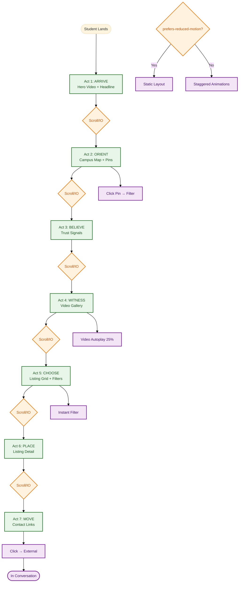
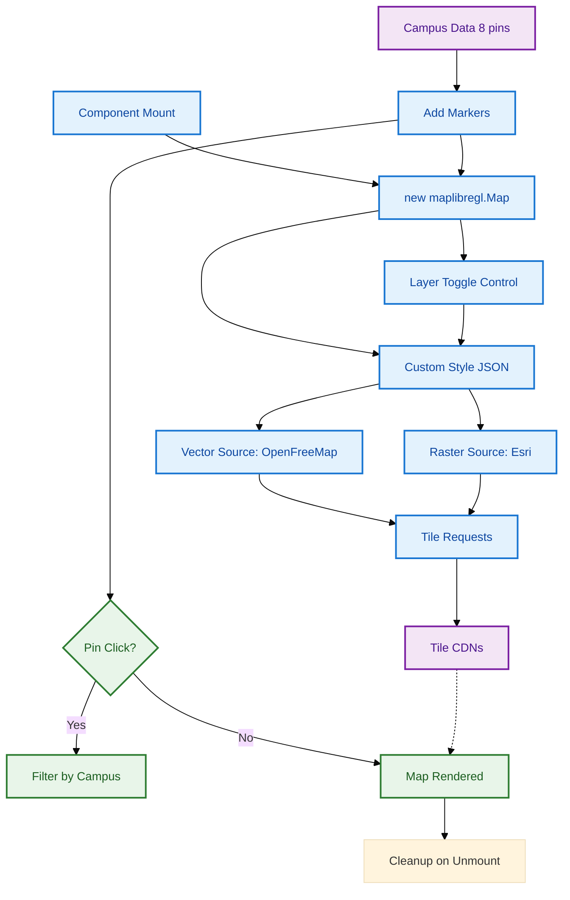
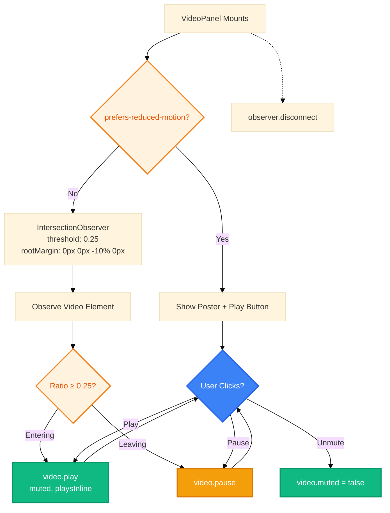
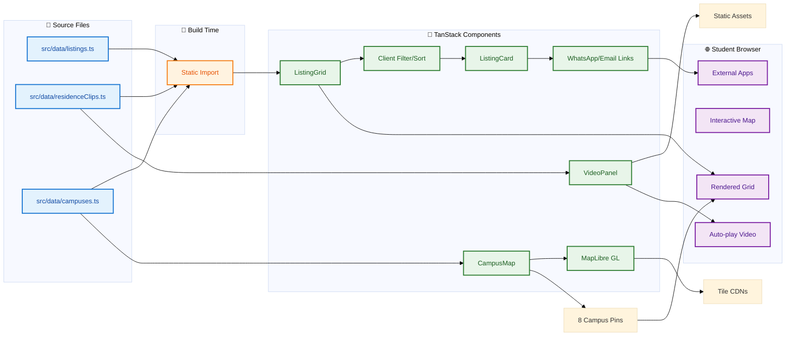
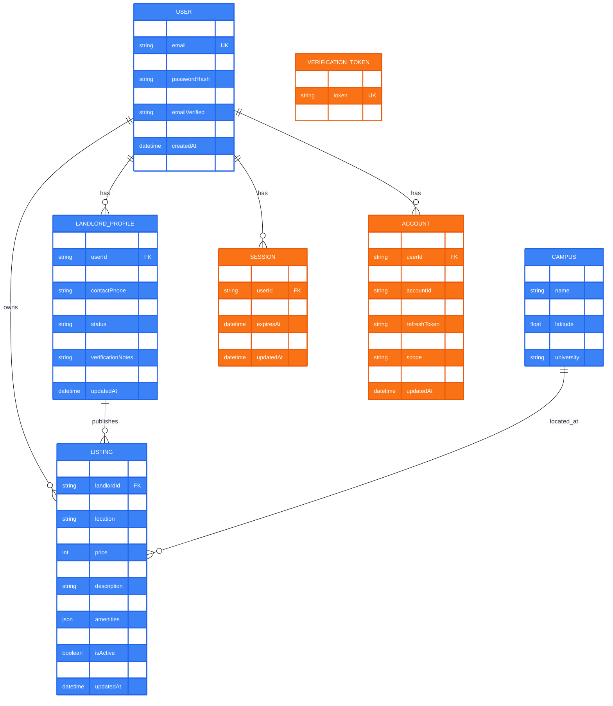
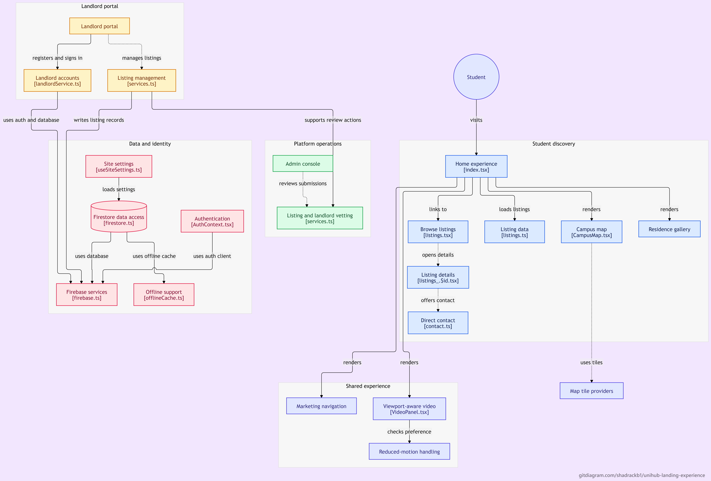

<h1 align="center">UniHub</h1>
<p align="center">
  <strong>Verified student housing discovery platform for Kenyan university campuses</strong>
  <br />
  <em>TanStack Start · React 19 · Better Auth · Prisma · MapLibre GL · Vercel</em>
</p>

<p align="center">
  <a href="#quick-start"></a>
  <a href="#license"></a>
</p>

<p align="center">
  
  
</p>

<p align="center">
  <a href="README.md">English</a>
</p>

---

## Features

| Feature | Description |
|---|---|
| Campus-Centric Discovery | Interactive MapLibre GL map with 8 Kenyan campus pins (Nairobi, Juja, Kahawa, Madaraka, Thika, Kesses, Njoro, Nakuru) |
| Verified Listings Only | Property data manually verified off-platform before publication — no fake photos or scam listings |
| Zero-Barrier Browsing | Students search and filter listings without accounts, cookies, or tracking |
| Direct Contact Links | WhatsApp and email links open external apps — UniHub never intermediates communication |
| 7-Act Homepage Funnel | Scroll-triggered narrative: Arrive → Orient → Believe → Witness → Choose → Place → Move |
| Dual Auth Stack (Migration) | Better Auth (primary) for admin routes; Firebase Auth/Firestore (legacy) for landlord portal |
| Viewport-Aware Video | IntersectionObserver autoplays videos at 25% visibility, respects `prefers-reduced-motion` |
| Extreme Data Minimisation | Zero student personal data collected; landlord data gathered off-platform via WhatsApp |

---

## Quick Start

### Prerequisites

- Node.js 20.11.0 or higher
- npm 10+

### Install

```bash
git clone https://github.com/shadrackb1/unihub-landing-experience.git
cd unihub-landing-experience
npm install
```

### Configure

```bash
cp .env.example .env
# Edit .env with your values (see Configuration section)
```

### Database Setup

```bash
# Generate Prisma client
npx prisma generate

# Run migrations (creates dev.db with schema)
npx prisma migrate dev --name init

# Seed test accounts (7 users across 5 roles)
npm run db:seed
```

**Seeded test accounts:**

| Role | Email | Password |
|---|---|---|
| Admin | admin@unihub.ke | TestAdmin2024! |
| Landlord (Pending) | landlord.pending@unihub.ke | TestLandlord2024! |
| Landlord (Approved) | landlord.approved@unihub.ke | TestLandlord2024! |
| Landlord (Rejected) | landlord.rejected@unihub.ke | TestLandlord2024! |
| Landlord (Suspended) | landlord.suspended@unihub.ke | TestLandlord2024! |
| Student / Tenant | student@unihub.ke | TestStudent2024! |
| University Admin | university@unihub.ke | TestUniversity2024! |

> Change passwords after first login.

### Run Development Server

```bash
npm run dev
```

Server starts at **http://localhost:5173** with HMR.

---

## Architecture

### System Overview

```mermaid
%%{init: {'theme': 'base', 'themeVariables': {'fontSize': '14px'}}}%%
flowchart TB
    subgraph Frontend["🌐 Frontend (Browser)"]
        React[React 19 + TanStack Router]
        MapLibre[MapLibre GL]
        VideoPanel[VideoPanel Component]
    end
    
    subgraph App["⚡ Application Layer (TanStack Start)"]
        SSR[SSR + File-based Routes]
        ServerFn[createServerFn]
        StaticData[Static Listings TS]
    end
    
    subgraph Auth["🔐 Authentication (Dual Stack)"]
        BetterAuth[Better Auth + Prisma Adapter]
        FirebaseAuth[Firebase Auth (Legacy)]
        Firestore[Firestore (Legacy)]
    end
    
    subgraph Data["💾 Data Layer"]
        SQLite[(SQLite via libsql)]
        Prisma[Prisma 7 ORM]
    end
    
    subgraph External["☁️ External Services"]
        Vercel[Vercel iad1]
        GitHub[GitHub]
        TileProviders[OpenFreeMap / Esri]
    end
    
    React --> SSR
    MapLibre --> TileProviders
    VideoPanel --> React
    SSR --> ServerFn
    SSR --> StaticData
    SSR --> BetterAuth
    BetterAuth --> Prisma
    Prisma --> SQLite
    FirebaseAuth -.-> Firestore
    Vercel --> React
    GitHub --> Vercel
    
    classDef primary fill:#10B981,stroke:#059669,color:#fff,stroke-width:2px
    classDef legacy fill:#F59E0B,stroke:#D97706,color:#fff,stroke-width:2px
    classDef external fill:#3B82F6,stroke:#2563EB,color:#fff,stroke-width:2px
    class BetterAuth,Prisma,SQLite primary
    class FirebaseAuth,Firestore legacy
    class Vercel,GitHub,TileProviders external
```

### Authentication Flow (Better Auth Primary + Firebase Legacy)

```mermaid
%%{init: {'theme': 'base', 'themeVariables': {'fontSize': '14px'}}}%%
flowchart TD
    Start([User visits /admin or /landlord]) --> Path{Route path?}
    
    Path -->|/admin/*| AdminGuard[requireAdmin Guard]
    Path -->|/landlord/*| LandlordGuard[LandlordContext Guard]
    
    AdminGuard --> WaitUser[waitForUser 8s timeout]
    WaitUser --> FirebaseAuth[Firebase Auth State]
    WaitUser --> Timeout[8s Fallback]
    FirebaseAuth --> HasSession{Session valid?}
    Timeout --> HasSession
    
    HasSession -->|No| RedirectLogin[Redirect /admin/login]
    HasSession -->|Yes| AdminEmails{VITE_ADMIN_EMAILS?}
    
    AdminEmails -->|Not configured| DevAllow[Allow + Warn]
    AdminEmails -->|Configured| EmailCheck{Email in list?}
    
    DevAllow --> AdminAccess[Admin Access Granted ✅]
    EmailCheck -->|No| RedirectHome[Redirect /]
    EmailCheck -->|Yes| AdminAccess
    
    LandlordGuard --> FirebaseAuth2[Firebase Auth State]
    FirebaseAuth2 --> Authenticated{Authenticated?}
    Authenticated -->|No| LandlordLogin[Redirect /landlord/login]
    Authenticated -->|Yes| FetchProfile[fetchLandlordProfile 8s timeout]
    
    FetchProfile --> ProfileState{Profile state?}
    ProfileState -->|ok| StatusRoute[homeForStatus]
    ProfileState -->|missing| Pending[/landlord/pending]
    ProfileState -->|unavailable| ErrorMsg[Show error]
    
    StatusRoute -->|pending| Pending
    StatusRoute -->|approved| Dashboard[/landlord]
    StatusRoute -->|rejected| Rejected[/landlord/rejected]
    StatusRoute -->|suspended| Suspended[/landlord/suspended]
    
    classDef success fill:#10B981,stroke:#059669,color:#fff,stroke-width:2px
    classDef warning fill:#F59E0B,stroke:#D97706,color:#fff,stroke-width:2px
    classDef error fill:#F43F5E,stroke:#E11D48,color:#fff,stroke-width:2px
    class AdminAccess,Dashboard success
    class DevAllow,Pending warning
    class RedirectLogin,RedirectHome,LandlordLogin,Rejected,Suspended,ErrorMsg error
```

### 7-Act Funnel — Homepage Experience



### Campus Map Data Flow — MapLibre GL



### Video Panel — Viewport-Aware Autoplay



### Data Flow — Static Listings to Browser



### Entity Relationship Diagram — Prisma Schema



---

## Configuration

### Environment Variables

| Variable | Description | Default | Required |
|---|---|---|---|
| `DATABASE_URL` | SQLite database file path | `file:./dev.db` | Yes |
| `BETTER_AUTH_SECRET` | 64-char secret for session encryption | — | Yes |
| `BETTER_AUTH_URL` | Auth callback base URL | `http://localhost:5173` | Yes |
| `VITE_APP_URL` | Frontend application URL | `http://localhost:5173` | Yes |
| `VITE_WHATSAPP_NUMBER` | Default WhatsApp number for listings | `254700000000` | No |
| `VITE_ADMIN_EMAILS` | Comma-separated admin emails | — | No |

Generate `BETTER_AUTH_SECRET`:
```bash
openssl rand -base64 32
```

### Key Files

| File | Purpose |
|---|---|
| `.env.example` | Template for environment variables |
| `prisma/schema.prisma` | Database schema (SQLite) |
| `vercel.json` | Vercel deployment config (iad1 region) |
| `tsconfig.json` | TypeScript config with path aliases |
| `vite.config.ts` | Vite + TanStack Start config |

---

## Project Structure

```
unihub-landing-experience/
├── public/                       # Static assets
│   ├── logo.svg                  # Horizontal wordmark
│   ├── logo-mark.svg             # Monogram-only variant
│   └── favicon.svg               # 64x64 rounded square
├── src/
│   ├── assets/                   # Local MP4 videos & images
│   ├── components/               # Shared UI components
│   │   └── ui/                   # Reusable primitives (buttons, cards, dialogs)
│   ├── data/                     # Static data (listings, residence clips, campuses)
│   ├── features/                 # Feature-based modules
│   │   ├── admin/                # Admin dashboard & guards
│   │   │   ├── components/       # Admin UI components
│   │   │   ├── pages/            # Admin pages
│   │   │   ├── routes/           # Admin routes (TanStack Router)
│   │   │   └── requireAdmin.ts   # Auth guard for admin routes
│   │   ├── auth/                 # Auth routes (login, register)
│   │   ├── campus/               # Campus map & data
│   │   ├── landlord/             # Landlord portal
│   │   │   ├── components/
│   │   │   ├── pages/
│   │   │   ├── routes/
│   │   │   └── services/         # landlordService.ts (Firebase Auth + Firestore)
│   │   ├── listings/             # Browse & manage listings
│   │   │   ├── components/       # ListingGrid
│   │   │   ├── hooks/            # useListings
│   │   │   └── routes/
│   │   ├── marketplace/          # AI description assistant
│   │   └── residence/            # Hostels, apartments, rooms
│   ├── hooks/                    # Shared hooks
│   ├── lib/                      # Core utilities
│   │   ├── auth/                 # Better Auth server config
│   │   ├── auth-client.ts        # Better Auth React client
│   │   ├── utils.ts              # cn() tailwind merge
│   │   └── withTimeout.ts        # Promise timeout utility
│   ├── routes/                   # File-based TanStack Router (legacy paths)
│   ├── shared/
│   │   ├── components/           # Experience, VideoPanel, MarketingChrome
│   │   ├── context/              # AuthContext, LandlordContext
│   │   ├── hooks/                # useOnlineRefresh, useSiteSettings
│   │   ├── lib/                  # Firebase config (legacy)
│   │   ├── services/             # Firestore CRUD (legacy)
│   │   └── contact.ts            # WhatsApp/email constants
│   ├── server.ts                 # Nitro server entrypoint
│   ├── start.ts                  # TanStack Start handler
│   ├── styles.css                # OKLCH design tokens + Tailwind v4
│   └── router.tsx                # Router instance
├── prisma/
│   ├── schema.prisma             # Prisma data model (SQLite)
│   ├── migrations/               # Migration history
│   └── seed.ts                   # TypeScript seeder
├── scripts/                      # Utility scripts (DPIA, consent PDFs)
├── docs/                         # Architecture diagrams (JSON + PNG + SVG)
├── AGENT_ONBOARDING.md           # AI agent setup guide
├── package.json
├── tsconfig.json
├── vite.config.ts
├── vercel.json
└── eslint.config.js
```

---

## Tech Stack

### Frontend

| Technology | Purpose | Version |
|---|---|---|
| TanStack Start | Full-stack React framework with SSR | 1.168 |
| React | UI library | 19 |
| TypeScript | Type-safe development | 5.8 |
| Tailwind CSS | Utility-first styling with OKLCH tokens | v4 |
| TanStack Router | File-based routing | 1.170 |
| MapLibre GL | Interactive campus map (no API keys) | 5.24 |
| Radix UI | Accessible UI primitives | 1.1-1.2 |
| Lucide Icons | Icon system | 0.575 |
| Motion | Animations | 14.0 |
| React Hook Form | Form handling | 7.71 |
| Zod | Schema validation | 3.25 |

### Authentication & Database

| Technology | Purpose | Version |
|---|---|---|
| Better Auth | Modern auth (email/password, admin plugin) | 1.7 |
| Prisma ORM | Type-safe database access (SQLite) | 7.10 |
| @prisma/adapter-libsql | Driver adapter for SQLite | 7.10 |
| Firebase Auth | Legacy landlord portal auth | 13.0 |
| Firestore | Legacy landlord portal database | 13.0 |

### Build & Infrastructure

| Technology | Purpose | Version |
|---|---|---|
| Vite | Build tool and dev server | 8.1 |
| Nitro | Server output and deployment preset | 3.0 |
| Vercel | Hosting and deployment | — |
| ESLint + Prettier | Code quality and formatting | 9.32 / 3.7 |
| tsx | TypeScript execution for scripts | 4.23 |

---

## Deployment (Vercel)

<p align="center">
  <a href="https://vercel.com/new/clone?repository-url=https://github.com/shadrackb1/unihub-landing-experience"></a>
</p>

```bash
npm run build
npm run preview
```

**vercel.json:**
```json
{
  "$schema": "https://openapi.vercel.sh/vercel.json",
  "framework": null,
  "buildCommand": "npm run build",
  "outputDirectory": ".vercel/output",
  "installCommand": "npm install",
  "devCommand": "npm run dev",
  "regions": ["iad1"]
}
```

Deploy steps:
1. Import `shadrackb1/unihub-landing-experience` into Vercel
2. Set Node.js runtime to `20.x`
3. Confirm build command and output directory
4. Deploy (no env vars or map API keys required for core features)

---

## Architecture Diagrams (All in `/docs/diagrams`)

| Diagram | Description | Format |
|---|---|---|
| `system-overview.json` | High-level system component architecture | JSON (Diagrammer) |
| `auth-flow.json` | Better Auth + Firebase dual stack flow | JSON (Diagrammer) |
| `data-flow.json` | Static listings → components → browser | JSON (Diagrammer) |
| `deployment-pipeline.json` | GitHub → Vercel CI/CD pipeline | JSON (Diagrammer) |
| `funnel-flow.json` | 7-Act homepage funnel experience | JSON (Diagrammer) |
| `map-dataflow.json` | MapLibre GL tile sources + campus pins | JSON (Diagrammer) |
| `video-panel.json` | IntersectionObserver viewport autoplay | JSON (Diagrammer) |
| `admin-guards.json` | TanStack Router loaders + requireAdmin | JSON (Diagrammer) |
| `landlord-portal.json` | Firebase Auth + Firestore registration/sign-in | JSON (Diagrammer) |
| `er-diagram.json` | Prisma schema entity relationships | JSON (Diagrammer) |
| `data-processing.json` | DPIA-aligned personal data flows | JSON (Diagrammer) |
| `security-boundaries.json` | Defense-in-depth security controls | JSON (Diagrammer) |
| `transfer-assessment.json` | International transfer DPA 2019 Part VI | JSON (Diagrammer) |
| `architecture-1.png` | System architecture overview (downloaded) | PNG |
| `architecture-2.png` | System architecture detail (downloaded) | PNG |
| `experience-funnel.svg` | 7-Act funnel (animated, legacy) | SVG |
| `technical-architecture.svg` | Technical architecture (legacy) | SVG |
| `routes-architecture.svg` | TanStack + Legacy SPA routes (legacy) | SVG |
| `backend-architecture.svg` | Services + Firebase/Cloud (legacy) | SVG |
| `legacy-spa-architecture.svg` | Legacy SPA internals (legacy) | SVG |
| `map-dataflow-animated.svg` | Campus MapLibre flow (animated, legacy) | SVG |
| `video-panel-animated.svg` | VideoPanel logic (animated, legacy) | SVG |
| `funnel-animated.svg` | 7-Act funnel (animated, legacy) | SVG |

> **JSON diagrams** render in the [Diagrammer viewer](https://diagrammer.dev) — paste the JSON to view interactive, zoomable diagrams.
> **SVG diagrams** open directly in browser for animations and hover effects.
> **PNG diagrams** render directly in this README at 800px width.

---

## System Architecture Diagrams (PNG)

### System Architecture Diagram 1
<p align="center">
  
</p>

### System Architecture Diagram 2
<p align="center">
  
</p>

---

## Key Commands

```bash
# Development
npm run dev              # Start dev server
npm run build            # Production build
npm run preview          # Preview production build

# Database
npx prisma generate      # Generate Prisma client
npx prisma migrate dev   # Run migrations
npx prisma studio        # Open Prisma Studio (GUI)
npm run db:seed          # Seed test accounts

# Code Quality
npm run lint             # ESLint
npm run format           # Prettier
```

---

## Developer Navigation Guide

| Task | File / Directory |
|---|---|
| Add a new page | `src/routes/` or `src/features/*/routes/` |
| Add API endpoint | `src/routes/api/` |
| Modify auth | `src/lib/auth/index.ts` |
| Modify DB schema | `prisma/schema.prisma` |
| Change UI tokens | `src/styles.css` (OKLCH colors, spacing) |
| Add test account | `prisma/seed.ts` → `TEST_ACCOUNTS` array |
| Debug landlord flow | `src/features/landlord/` |
| Debug admin guard | `src/features/admin/requireAdmin.ts` |
| Shared timeout utility | `src/shared/lib/withTimeout.ts` |
| Static listing data | `src/data/listings.ts` |
| Residence video clips | `src/data/residenceClips.ts` |
| Campus data | `src/data/campuses.ts` |

---

## Routing

- **TanStack Router** file-based: `src/routes/` (legacy) + `src/features/*/routes/` (new)
- Route tree generated at `src/routeTree.gen.ts`
- Server functions via `createServerFn` in `src/start.ts`

---

## Data

- **Prisma 7** with `@prisma/adapter-libsql` (SQLite driver)
- Generated client at `node_modules/.prisma/client/client`
- Run scripts via `tsx` (`npx tsx scripts/...`)

---

## Accessibility & Quality Gates

- **Semantic HTML** — Proper landmarks (`header`, `main`, `section`, `nav`, `footer`)
- **Keyboard Navigation** — Skip links, visible focus rings, full keyboard control
- **Motion Gated** — All animations respect `prefers-reduced-motion`
- **Target Sizes** — Interactive elements meet 44×44 px minimum
- **Code Quality** — `npm run lint` and `npm run build` must pass

---

## Contributing

1. Fork the repository
2. Create a feature branch (`git checkout -b feature/amazing`)
3. Commit your changes (`git commit -m 'feat: add amazing feature'`)
4. Push to the branch (`git push origin feature/amazing`)
5. Open a Pull Request

---

## License

Private project. Map data subject to OpenStreetMap and Esri terms.

---

## Contact

- **WhatsApp** — Configurable via `VITE_WHATSAPP_NUMBER`
- **Email** — hello@unihub.ke
- **Repo** — https://github.com/shadrackb1/unihub-landing-experience

---

*UniHub — Verified student housing near Kenyan campuses.*