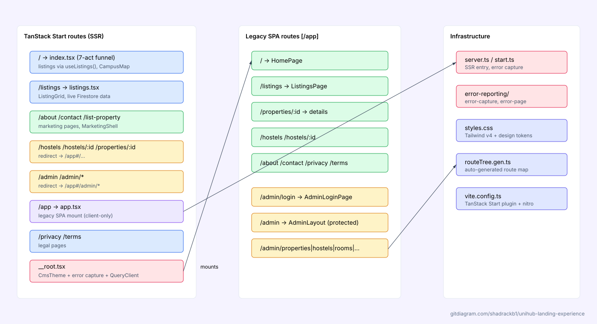
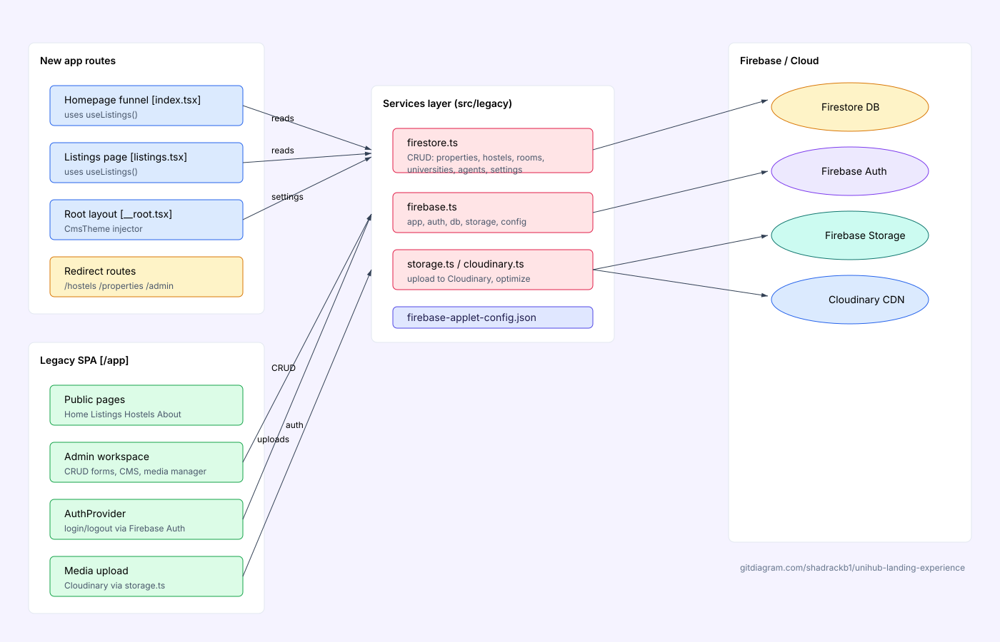
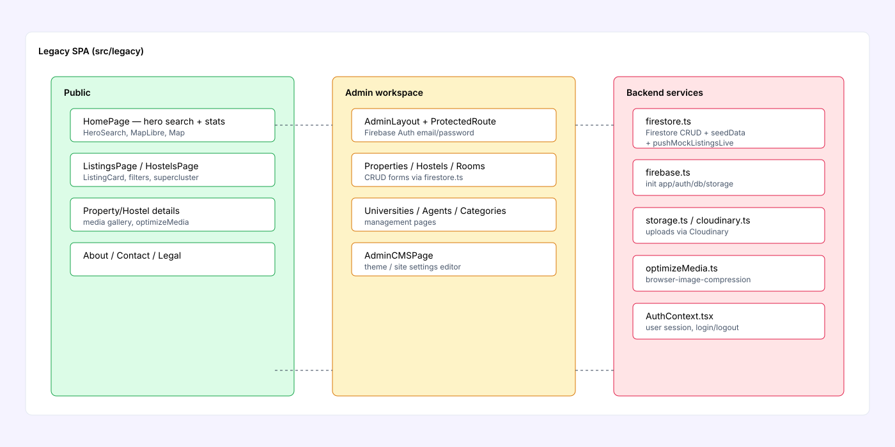
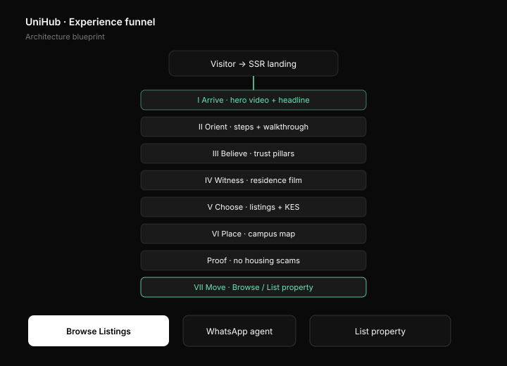
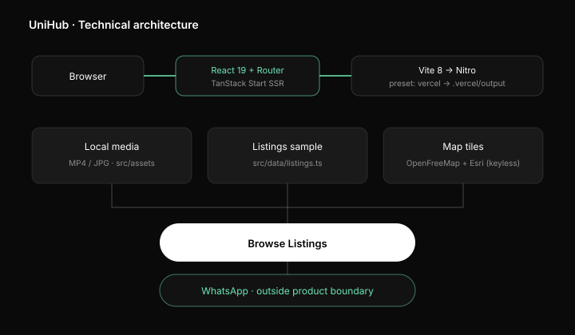

# UniHub — Verified Student Housing near Kenyan Campuses

**UniHub** is a modern, campus-first web application designed to help university students in Kenya discover verified hostels, bedsitters, single rooms, and shared apartments near their campuses. Listings are vetted before publication, eliminating fake photos and deposit scams. Students can search and browse freely without signup barriers, and contact landlords or agents directly via WhatsApp or email.

Live Repository: [github.com/shadrackb1/unihub-landing-experience](https://github.com/shadrackb1/unihub-landing-experience)

## Architecture


### Route map



### Backend / data layer



### Legacy SPA internals



---

## Table of Contents

- [Why UniHub](#why-unihub)
- [Product Surface & Routing](#product-surface--routing)
- [Homepage Architecture (7-Act Funnel)](#homepage-architecture-7-act-funnel)
- [Tech Stack](#tech-stack)
- [Project Directory Structure](#project-directory-structure)
- [Getting Started & Local Development](#getting-started--local-development)
- [Offline USB Presentation Package](#offline-usb-presentation-package)
- [Brand & Design System](#brand--design-system)
- [Interactive Campus Map](#interactive-campus-map)
- [Data Contracts & Schemas](#data-contracts--schemas)
- [Deployment (Vercel)](#deployment-vercel)
- [Lovable Integration & Git Workflow](#lovable-integration--git-workflow)
- [Error Capture & Reporting](#error-capture--reporting)
- [Accessibility & Quality Gates](#accessibility--quality-gates)
- [Contributing](#contributing)
- [License & Contact](#license--contact)

---

## Why UniHub

Finding student accommodation near Kenyan universities traditionally involves scattered WhatsApp groups, unverified social media listings, fake photos, and risky advance deposits. UniHub consolidates trusted inventory into a single campus-centric platform:

| Core Pillar | Value Proposition |
| --- | --- |
| **Verified Listings** | Property and landlord details are vetted before publication to ensure authenticity. |
| **Campus-First IA** | Search structured by specific university towns (Nairobi, Juja, Kahawa, Madaraka, Thika, Kesses, Njoro, Nakuru). |
| **Direct Contact** | One-tap WhatsApp or email connection directly to the verified listing agent or landlord. |
| **Zero Friction** | Free to browse with no mandatory signup or paywall standing between students and housing. |

---

## Product Surface & Routing

The application utilizes **TanStack Router** file-based routing (`src/routes/`):

| Route | Page / Component | Description |
| --- | --- | --- |
| `/` | `src/routes/index.tsx` | Full 7-Act marketing experience (Hero, Walkthrough, Trust, Films, Listings, Map, Onboarding CTA) |
| `/listings` | `src/routes/listings.tsx` | Verified inventory catalog with category filters and price details |
| `/about` | `src/routes/about.tsx` | Brand story, company mission, and core housing pillars |
| `/contact` | `src/routes/contact.tsx` | Support center with direct WhatsApp integration and campus coverage info |
| `/list-property` | `src/routes/list-property.tsx` | Landlord & agent property onboarding portal |
| `/privacy` | `src/routes/privacy.tsx` | Data privacy policy stub |
| `/terms` | `src/routes/terms.tsx` | Terms of service and listing usage guidelines stub |

---

## Homepage Architecture (7-Act Funnel)

The homepage (`src/routes/index.tsx`) is structured as a sequential seven-act conversion journey:

```
[ Navigation Header: Logo · Journey · Listings · About · Contact · List Property ]

ACT I    ARRIVE     Looping hero video, letter-animated headline, campus pill codes
         ↓
ACT II   ORIENT     Four-step housing journey + interactive site walkthrough video
         ↓
ACT III  BELIEVE    Trust pillars: Verified listings, renter-focused design, direct contact
         ↓
ACT IV   WITNESS    Residence video film strip (Qwetu & room tour clips)
         ↓
ACT V    CHOOSE     Featured verified listings with KES pricing + embedded video preview
         ↓
ACT VI   PLACE      Interactive MapLibre GL campus map with keyless dark/satellite layers
         ↓
         PROOF      Anti-scam verification statement & trust checkpoint
         ↓
ACT VII  MOVE       Landlord/Agent onboarding call-to-action & final browse bar
         ↓
[ Navigation Footer: Quick Links · Legal · WhatsApp Agent Button ]
```

### Experience Funnel Diagram



*Visual representation of the 7-act conversion funnel from visitor arrival to property listing engagement.*

---

## Tech Stack

| Layer | Technology Choice |
| --- | --- |
| **Framework & SSR** | [TanStack Start](https://tanstack.com/start) + [React 19](https://react.dev/) + [TypeScript](https://www.typescriptlang.org/) |
| **Build & Tooling** | [Vite 8](https://vitejs.dev/) + [Nitro 3](https://nitro.unjs.io/) |
| **Routing** | [TanStack Router](https://tanstack.com/router) (file-based in `src/routes/`) |
| **Styling** | [Tailwind CSS v4](https://tailwindcss.com/) with OKLCH tokens defined in `src/styles.css` |
| **Interactive Map** | [MapLibre GL](https://maplibre.org/) with OpenFreeMap & Esri World Imagery (**no API keys required**) |
| **UI Components** | Custom glassmorphism UI + Radix UI primitives (`@radix-ui/*`) + [Lucide Icons](https://lucide.dev/) |
| **Hosting & Deployment** | [Vercel](https://vercel.com/) (Nitro `vercel` preset producing `.vercel/output`) |

### Technical Architecture Diagram



*High-level architecture showing the data flow from browser through React/TanStack Start to Vite/Nitro build pipeline, with local media, listings data, and keyless map tile providers.*

---

## Project Directory Structure

```
unihub-landing-experience/
├── public/                       # Static public assets, logo, favicons, ad materials
│   ├── logo.svg                  # Brand horizontal lockup
│   ├── logo-mark.svg             # Monogram mark
│   └── favicon.svg               # Site favicon
├── src/                          # Application source code
│   ├── assets/                   # Local MP4 video clips and listing hero images
│   ├── components/               # Core UI experience components
│   │   ├── ui/                   # Reusable UI primitives (buttons, cards, dialogs, etc.)
│   │   ├── CampusMap.tsx         # MapLibre GL keyless map with university pins
│   │   ├── Experience.tsx        # Journey timeline & act scroll navigation
│   │   ├── LetterReveal.tsx      # Staggered typography animations
│   │   ├── ListingGrid.tsx       # Housing card grid component
│   │   ├── Logo.tsx              # SVG Logo & Mark components
│   │   ├── MarketingChrome.tsx   # Header navigation bar & footer chrome
│   │   ├── ResidenceVideoGallery.tsx # Residence video clip showcase
│   │   └── VideoPanel.tsx        # Viewport-aware autoplaying video container
│   ├── data/                     # Data definitions and mock listings
│   │   └── listings.ts           # Sample verified property listings & types
│   ├── hooks/                    # Custom React hooks
│   │   └── use-mobile.tsx        # Responsive viewport detection hook
│   ├── lib/                      # Utilities and error reporting infrastructure
│   │   ├── error-capture.ts      # Server-side & browser error interceptor
│   │   ├── error-page.ts         # Standard error response formatter
│   │   ├── error-reporting.ts    # Client-side runtime error reporting
│   │   └── utils.ts              # Tailwind class merging utility (`cn`)
│   ├── routes/                   # File-based TanStack Router pages
│   │   ├── __root.tsx            # Root layout shell (HTML, Head, Meta, Body)
│   │   ├── index.tsx             # Homepage (7-Act experience)
│   │   ├── listings.tsx          # Browse listings page
│   │   ├── about.tsx             # About brand page
│   │   ├── contact.tsx           # Contact & WhatsApp page
│   │   ├── list-property.tsx     # Landlord onboarding page
│   │   ├── privacy.tsx           # Privacy policy page
│   │   └── terms.tsx             # Terms of service page
│   ├── router.tsx                # TanStack Router instance creation
│   ├── server.ts                 # Nitro server entrypoint with error recovery
│   ├── start.ts                  # TanStack Start handler
│   └── styles.css                # OKLCH design tokens & Tailwind 4 utilities
├── DESIGN-BLUEPRINT.md           # System design & architecture blueprint specification
├── OFFLINE-README.md             # Guide for running the offline USB package
├── vite.config.ts                # Vite & TanStack Start configuration
├── vercel.json                   # Vercel deployment configuration
├── eslint.config.js              # Flat ESLint rules
├── tsconfig.json                 # TypeScript compiler configuration
└── package.json                  # Dependencies and scripts
```

---

## Getting Started & Local Development

### Prerequisites

- **Node.js**: `20.11.0` or higher
- **Package Manager**: `npm` (v10+) or `bun`

### Installation & Execution

1. Clone the repository:
   ```sh
   git clone https://github.com/shadrackb1/unihub-landing-experience.git
   cd unihub-landing-experience
   ```

2. Install dependencies:
   ```sh
   npm install
   ```

3. Launch the development server:
   ```sh
   npm run dev
   ```

4. Open your browser at `http://localhost:3000`.

### CLI Scripts Reference

| Script | Command | Description |
| --- | --- | --- |
| `npm run dev` | `vite dev` | Starts local Vite development server with HMR |
| `npm run build` | `vite build` | Production build targeting `.vercel/output` |
| `npm run build:dev` | `vite build --mode development` | Development mode build with unminified output |
| `npm run preview` | `vite preview` | Previews production build output locally |
| `npm run lint` | `eslint .` | Runs ESLint analysis across codebase |
| `npm run format` | `prettier --write .` | Formats codebase using Prettier |

---

## Offline USB Presentation Package

UniHub supports fully offline operation for presentations, field demos, and local server deployments without internet access.

For detailed offline execution instructions, consult [`OFFLINE-README.md`](OFFLINE-README.md).

### Quick Offline Execution

When using the pre-packaged USB bundle on Windows:
1. Navigate to the `offline/` directory on the USB drive.
2. Run `START-OFFLINE.bat` (requires Node.js installed on host machine).
3. Open `http://localhost:3000` in Google Chrome or Microsoft Edge.

All images, video assets, and stylesheets are bundled locally. Map background rendering falls back gracefully if network connection to tile servers is absent.

---

## Brand & Design System

The visual language follows a dark, campus-focused aesthetic built using OKLCH color spaces in `src/styles.css`.

### Design Tokens

| Token Role | CSS Variable | Visual Characteristic |
| --- | --- | --- |
| **Canvas Background** | `--background` | Deep near-black (`#0A0A0A` family) |
| **Panels & Elevation** | `--card` / `--panel` | Translucent glassmorphism cards with fine borders |
| **Primary Ink** | `--foreground` | Crisp white text for optimal dark mode contrast |
| **Highlight Accent** | `--highlight` | Scarce mint green (`#00F5A0` family) strictly reserved for verification badges |
| **Typography Display** | `Space Grotesk` | Headings, campus codes, prices, and emphasis numbers |
| **Typography Body** | `Inter` | Body paragraphs, nav links, and form labels |

### Motion & Animation Principles

- **Letter Reveal**: Staggered rise and unblur effect on headline text (`src/components/LetterReveal.tsx`).
- **Scroll Autoplay**: Video containers (`src/components/VideoPanel.tsx`) utilize `IntersectionObserver` to automatically play when visible and pause when scrolled out of view.
- **Accessibility**: All animations and video autoplays strictly respect system `prefers-reduced-motion` settings.

### Brand Assets (SVG)

All brand assets are resolution-independent SVG files located in `public/`:

| Asset | Path | Description |
| --- | --- | --- |
| **Horizontal Logo** | `public/logo.svg` | Full wordmark with monogram — used in navigation headers |
| **Logo Mark** | `public/logo-mark.svg` | Monogram-only variant — used for favicon, social cards, app icons |
| **Favicon** | `public/favicon.svg` | 64×64 rounded square with monogram and verification spark |
| **Experience Funnel** | `docs/diagrams/experience-funnel.svg` | 7-act conversion funnel visualization |
| **Technical Architecture** | `docs/diagrams/technical-architecture.svg` | System architecture and data flow diagram |


---

## App Screenshots & Media Assets

The application includes a comprehensive set of local media assets (MP4 videos and JPG images) stored in `src/assets/` for fully offline operation:

### Hero & Walkthrough Videos

| Asset | Description |
| --- | --- |
| `unihub-hero.mp4` | Looping hero background video for Act I (Arrive) |
| `unihub-hero-poster.jpg` | Poster frame for hero video |
| `unihub-site-walkthrough.mp4` | Interactive site walkthrough video for Act II (Orient) |
| `unihub-walkthrough-poster.jpg` | Poster frame for walkthrough video |

### Residence Video Gallery (Act IV - Witness)

| Video | Poster | Description |
| --- | --- | --- |
| `unihub-qwetu-documentary.mp4` | `unihub-qwetu-poster.jpg` | Qwetu residence documentary |
| `listing-video-maison.mp4` | `listing-video-maison-poster.jpg` | Maison residence tour |
| `listing-video-female-hostel.mp4` | `listing-video-female-hostel-poster.jpg` | Female hostel tour |
| `listing-video-student-rooms.mp4` | `listing-video-student-rooms-poster.jpg` | Student rooms showcase |

### Listing Hero Images (Act V - Choose)

| Image | Category | Used In |
| --- | --- | --- |
| `listing-hostel.jpg` | Hostel | Featured listings grid |
| `listing-bedsitter.jpg` | Bedsitter | Featured listings grid |
| `listing-studio.jpg` | Studio | Featured listings grid |
| `listing-apartment.jpg` | Apartment | Featured listings grid |
| `listing-shared.jpg` | Shared apartment | Featured listings grid |
| `listing-twin-hostel.jpg` | Twin hostel | Featured listings grid |

All media assets are optimized for web delivery and bundled for the offline USB presentation package.

---

## Interactive Campus Map

The campus map component (`src/components/CampusMap.tsx`) provides location context across key student hubs in Kenya without requiring paid API keys or external tile subscriptions.

### Free Tile Providers

- **Dark Mode (Default)**: [OpenFreeMap](https://openfreemap.org) dark vector tile style.
- **Satellite Mode**: [Esri World Imagery](https://www.esri.com/) public tile server.

### Campus Locations Included

| Code | Institution / Region | Town / Belt | Latitude, Longitude |
| --- | --- | --- | --- |
| **UoN** | University of Nairobi | Nairobi | `-1.279, 36.814` |
| **JKUAT** | Jomo Kenyatta University | Juja | `-1.093, 37.015` |
| **KU** | Kenyatta University | Kahawa | `-1.174, 36.927` |
| **SU** | Strathmore University | Madaraka | `-1.310, 36.813` |
| **THK** | Thika Student Belt | Thika | `-1.033, 37.069` |
| **MU** | Moi University | Kesses | `0.295, 35.335` |
| **EGU** | Egerton University | Njoro | `-0.366, 35.944` |
| **NKU** | Nakuru Campus Belt | Nakuru | `-0.303, 36.080` |

---

## Data Contracts & Schemas

### Property Listing Schema (`src/data/listings.ts`)

```typescript
export type SampleListing = {
  title: string;     // E.g., "Modern Bedsitter in Juja Town"
  location: string;  // E.g., "Near JKUAT"
  category: string;  // E.g., "Bedsitter" | "Hostel" | "Single room" | "Studio" | "Shared apartment"
  price: string;     // E.g., "KES 9,500"
  deposit: string;   // E.g., "Deposit: 1 month"
  image: string;     // Imported asset path or URL
};
```

### Campus Pin Schema (`src/components/CampusMap.tsx`)

```typescript
export type CampusPin = {
  id: string;    // Unique string identifier
  code: string;  // Short code (e.g., "JKUAT")
  name: string;  // Full institution name
  town: string;  // Town / region
  lng: number;   // Longitude coordinate
  lat: number;   // Latitude coordinate
};
```

---

## Deployment (Vercel)

The application is optimized for Vercel deployment via Nitro's `vercel` build output preset (`.vercel/output`).

### `vercel.json` Configuration

```json
{
  "$schema": "https://openapi.vercel.sh/vercel.json",
  "framework": null,
  "buildCommand": "npm run build",
  "outputDirectory": ".vercel/output",
  "installCommand": "npm install",
  "devCommand": "npm run dev",
  "regions": ["iad1"],
  "git": {
    "deploymentEnabled": {
      "main": true
    }
  }
}
```

### Deployment Steps

1. Import `shadrackb1/unihub-landing-experience` into your Vercel account.
2. Ensure Node.js runtime is set to `20.x`.
3. Confirm build command is `npm run build` and output directory is `.vercel/output`.
4. Deploy. No environment variables or map API keys are required for v1.

---

## Lovable Integration & Git Workflow

> [!IMPORTANT]
> This repository is connected to [Lovable](https://lovable.dev).
>
> Avoid rewriting published Git history on the `main` branch (such as force-pushing `git push -f`, squashing published commits, or rebasing). Rewriting published history desynchronizes the project history in the Lovable editor. All commits pushed to `main` automatically sync back to Lovable.

---

## Error Capture & Reporting

UniHub includes robust server-side and browser error interceptors (`src/lib/error-capture.ts` and `src/server.ts`):

- **Stack Trace Preservation**: Captures deep cause chains and status codes that may otherwise be swallowed by underlying HTTP server wrappers.
- **Graceful Error Recovery**: Renders user-friendly fallback error screens (`src/lib/error-page.ts`) during unexpected runtime failures.
- **Runtime Error Reporting**: Integrates with `src/lib/error-reporting.ts` for reporting client-side runtime errors back to the environment logs.

---

## Accessibility & Quality Gates

- **Semantic HTML**: Proper sectioning with `<header>`, `<main>`, `<section>`, `<nav>`, and `<footer>` landmarks.
- **Keyboard Navigation**: Skip-to-main-content links, visible focus rings, and full keyboard control on map buttons and dialogs.
- **Motion Gated**: All scroll-linked reveals, letter animations, and video autoplays check `prefers-reduced-motion` media query before executing.
- **Target Sizes**: Interactive buttons and links adhere to minimum 44x44px touch target standards for mobile devices.

---

## Contributing

1. Fork or branch from `main`.
2. Ensure all linting checks and builds pass cleanly:
   ```sh
   npm run lint
   npm run build
   ```
3. Follow the established copy guidelines: concise, student-focused language without empty SaaS jargon.
4. Keep map tile integrations keyless and free unless approved.
5. Create a pull request against `main`. Avoid force-pushing.

---

## License & Contact

- **License**: Private project. All map data remains subject to OpenStreetMap and Esri license terms.
- **WhatsApp Support**: Configurable via `WHATSAPP_URL` in `src/components/MarketingChrome.tsx`
- **Email Contact**: `hello@unihub.ke`

*UniHub — Verified student housing near Kenyan campuses.*
